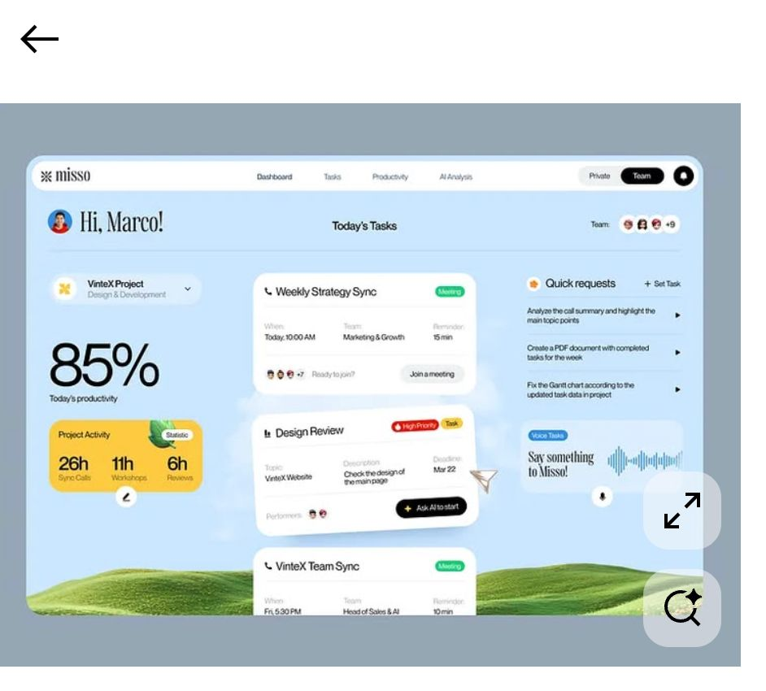

# Mi espacio · dashboard personal de productividad

Mi espacio es un dashboard personal: tareas, tablero Kanban, proyectos, notas, Pomodoro, estadísticas y Google Calendar. Su estética es cálida, con cielo pastel, colinas y tarjetas blancas. Está pensado para abrirse en **cada nueva pestaña de Chrome**.

- **Frontend:** React 19, TypeScript, Vite y Tailwind CSS v4.
- **Datos y login:** Supabase (Postgres con seguridad a nivel de fila y login con Google).
- **Hosting:** Vercel, con despliegue automático en cada `git push`. Las funciones serverless de `api/` gestionan Google Calendar.
- **Nueva pestaña:** extensión mínima de Chrome (Manifest V3) que carga la app alojada.



## Empezar en 1 minuto (modo demo)

```bash
npm install
npm run dev        # http://localhost:5173
```

Sin variables de entorno la app arranca en **modo demo**, con datos de ejemplo guardados en tu navegador. Así puedes verla y probarla antes de crear nada en la nube.

## Documentación

| Guía | Para qué sirve |
|---|---|
| [docs/INSTALL.md](docs/INSTALL.md) | Instalar en local y crear el proyecto de Supabase |
| [docs/DEPLOY.md](docs/DEPLOY.md) | Subir a GitHub y desplegar en Vercel |
| [docs/GOOGLE_TASKS.md](docs/GOOGLE_TASKS.md) | Conectar Google Tasks y mostrar sus listas como columnas del kanban |
| [docs/GOOGLE_CALENDAR.md](docs/GOOGLE_CALENDAR.md) | Crear credenciales de Google Cloud y conectar el calendario |
| [docs/EXTENSION.md](docs/EXTENSION.md) | Instalar la extensión de nueva pestaña |
| [docs/CUSTOMIZE.md](docs/CUSTOMIZE.md) | Cambiar colores, fondo, textos y widgets desde la terminal |
| [CODEX_TASKS.md](CODEX_TASKS.md) | Tareas delegadas a Codex (ilustraciones, revisión visual…) |

## Scripts

| Comando | Qué hace |
|---|---|
| `npm run dev` | Servidor local con recarga en caliente; también sirve `/api` |
| `npm run build` | Typecheck y build de producción en `dist/` |
| `npm run lint` / `npm run typecheck` | ESLint / TypeScript |
| `npm test` | Tests unitarios y de componentes (Vitest) |
| `npm run test:e2e` | Tests end-to-end en modo demo y de la extensión (Playwright) |
| `npm run check` | Lint, typecheck, tests y build |
| `npm run secrets:scan` | Comprueba que no se va a subir ningún secreto |
| `npm run build:extension -- --url https://tu-app.vercel.app` | Prepara `dist-extension/` y `dashboard-newtab.zip` |
| `npm run db:push` | Aplica las migraciones al proyecto de Supabase enlazado |

## Estructura

```
src/
  config/        ← textos, navegación, layout del inicio, saludo, fondo (editable)
  styles/        ← tokens.css: colores, radios, sombras, tipografías
  components/    ← ui/ (Card, Button, Chip, Modal…) y layout/ (SkyFrame, Sidebar)
  features/      ← dashboard, tasks, kanban, projects, notes, calendar, focus, stats, settings, auth
  data/          ← repositorio de datos: Supabase o demo (localStorage)
  lib/           ← lógica pura testeada: fechas, filtros, estadísticas, posiciones
  mocks/         ← datos de ejemplo
api/google/      ← funciones serverless de Google Calendar (OAuth y eventos)
supabase/        ← migraciones SQL, seed y comprobación de RLS
extension/       ← extensión de Chrome (nueva pestaña)
public/assets/generated/ ← ilustraciones y fondo (generados con Codex)
```

## Seguridad

- Cada tabla tiene **RLS** (`user_id = auth.uid()`). Solo pueden registrarse los emails de `allowed_emails`.
- El navegador solo conoce la clave *publishable* de Supabase. La clave secreta y las credenciales de Google viven en las variables de entorno de Vercel.
- Los refresh tokens de Google se guardan **cifrados (AES-256-GCM)** en una tabla que el navegador no puede leer.
- El `state` de OAuth va firmado con HMAC (protección CSRF).
- Solo tu extensión puede incrustar la app en un iframe (`frame-ancestors` en `vercel.json`).
